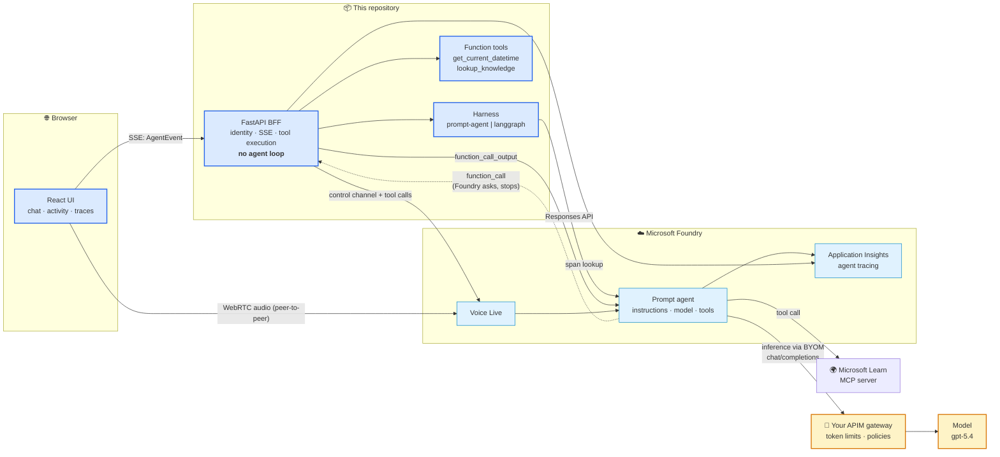

<div align="center">

# 🎙️ foundry-live-agent

### Microsoft Foundry Agent Service, end to end — with swappable agent harnesses

**The agent runs *in* Foundry. This repo is the app built *around* it.**
Streaming chat · live agent activity · distributed traces · real-time voice

<br />


<br />

**🌐 Language:** **English** · [Português 🇧🇷](./README.pt-BR.md)

</div>

---

> **Status: chat and voice both run.** Specs 000–004 and 006 are done — the harness contract, the
> prompt agent, the BFF, the UI, and **voice on the same agent**. Spec 005 (the trace drawer) is the
> remaining one. See [`specs/README.md`](specs/README.md); the architecture record is
> [`PLAN.md`](PLAN.md).

## 📑 Contents

1. [What this is](#-what-this-is) · 2. [Architecture](#-architecture) · 3. [Quickstart](#-quickstart-10-minutes)
4. [Screenshots](#-screenshots) · 5. [Harnesses](#-harnesses) · 6. [How we build here](#-how-we-build-here)
7. [Cost](#-cost) · 8. [Cleanup](#-cleanup)

---

## 🧭 What this is

Most agent tutorials put the agent loop in your application: your code picks the tools, calls the
model, and loops. This repository does the opposite, on purpose.

**The agent — its instructions, model and tools — lives in Microsoft Foundry.** This repo is
everything *around* it: identity, streaming, tool execution, tracing, voice and a UI. The backend is
a **BFF** with no agent-loop logic at all, and that boundary is enforced as
[constitution §8](.specify/constitution.md), not just described in prose.

That makes one thing possible which is otherwise hard: **the harness is swappable.** The same
frontend, BFF, gateway, traces and voice work whether Foundry runs the loop (a *prompt agent*) or
your container does (a *hosted agent* running LangGraph). Both sit behind one contract.

| | |
|---|---|
| 🔌 **One contract, two harnesses** | `HarnessAdapter` + a typed `AgentEvent` stream. `prompt-agent` ships; `langgraph` is scaffolded. |
| 🛠️ **Three tools, two owners** | Microsoft Learn MCP runs *in Foundry*; two function tools run *in the BFF* — because Foundry asks and stops. One line per call in the chat, the payload in the trace panel. |
| 🔍 **Traces you can see** | An Application Insights span tree in a drawer: agent run › model calls › tool calls, with durations and tokens. |
| 🗣️ **Voice on the same agent** | Voice Live attaches to the *same* definition — one agent, one tool set, one trace store, two modalities. |
| 🔊 **Answers you can hear** | A toggle reads the chat's answers aloud, sentence by sentence as they stream, synthesised by the BFF so the browser still holds no credential. |
| 🔐 **Zero secrets** | Entra ID via `DefaultAzureCredential` everywhere. The browser never holds an Azure credential. |

## 🏗️ Architecture



**Blue = we build it. Light blue = Foundry runs it. Amber = your gateway.** Three details worth
staring at:

- The dotted line: Foundry emits a `function_call` and **stops**. If the BFF doesn't answer, the run
  hangs and expires after 10 minutes. That round trip is the point of the whole design.
- **The gateway is not where you'd guess.** It does not sit between the app and the agent — it sits
  between the *agent* and the *model*. The project-level "AI Gateway" governs direct model calls and
  does **not** carry agent inference; routing the agent through your APIM is a separate feature
  (*bring your own model*), and it changes the model's name to `<connection>/<model>`.
- Voice audio goes **browser → Voice Live directly**; only the control channel (and the tool calls
  on it) touches our server. No Azure credential ever reaches the browser, and **Voice Live never
  passes through any gateway**.

Full detail: [`docs/architecture.md`](docs/architecture.md) · [`PLAN.md`](PLAN.md).

## 🚀 Quickstart (10 minutes)

**Prerequisites:** an Azure subscription · [Azure CLI](https://learn.microsoft.com/cli/azure/install-azure-cli) ·
[azd](https://learn.microsoft.com/azure/developer/azure-developer-cli/install-azd) ·
[just](https://github.com/casey/just) · Python 3.12 · Node 24 (Vite 8 needs ≥ 20.19; CI runs 24).

```bash
git clone https://github.com/reginaldosilva27/foundry-live-agent
cd foundry-live-agent

just env            # 1. create .env from the template
just login          # 2. az login — Entra ID, no API keys anywhere
just infra          # 3. azd up: Foundry resource, project, model, App Insights (~5 min)
just agent          # 4. apply the agent definition from ai/harness/prompt-agent/agent.yaml
just backend        # 5. the BFF on :8000
just frontend       # 6. the UI on :5173
```

Then ask something that forces both tool paths at once:

> *"What time is it in São Paulo, and what does the Foundry documentation say about hosted agents?"*

`get_current_datetime` runs **in the BFF**; the docs lookup runs **in Foundry** via the Learn MCP
server. Watch both land in the Agent activity panel, then open the trace drawer.

Optional — the AI Gateway is a portal flow with no IaC path: `just gateway` prints the steps.

## 📸 Screenshots

| | |
|---|---|
|  |  |
| _The three-pane shell, with the harness badge in the header_ | _A terminal `error` renders as an error, not as a stream that stopped_ |
|  | |
| _A live Voice Live session on the same agent — the transcript arrives on the WebRTC data channel_ | |

Both are real screenshots of a real run. The second one is what the app shows when the Foundry
project has no model deployment behind the gateway connection yet: the round trip completed, the
gateway answered `404`, and the contract turned that into a terminal event instead of silence.

One shot is still missing, and it is missing for a reason rather than out of neglect
(constitution §5):

| Missing | Waiting on |
|---|---|
| `screenshot-traces.png` — the span tree with durations | Spec 005 |

## 🔌 Harnesses

| | **prompt-agent** (ships now) | **langgraph** (planned) |
|---|---|---|
| Who runs the loop | Foundry | Your container, hosted by Foundry |
| Agent definition | `agent.yaml` → Agent Service SDK | `azure.yaml` → `azd` |
| Tools | Declared on the agent | Declared in the Responses call / a Toolbox |
| You maintain | Nothing at runtime | Your graph |
| Best for | Getting it working, and most production agents | Custom orchestration |

`AGENT_HARNESS=prompt-agent|langgraph` switches between them; the badge in the settings panel shows
which is live. `langgraph` is a **documented scaffold** — it raises `NotImplementedError` rather than
pretending to work. Trade-offs: [`docs/harness-comparison.md`](docs/harness-comparison.md).

## 🧪 How we build here

Spec-first, test-first, gates green — inherited from
[agentic-coding-template](https://github.com/reginaldosilva27/agentic-coding-template).

```
spec.md ──clarify──> plan.md ──> tasks.md ──TDD──> code + tests ──> gates green
```

```bash
just verify         # everything CI runs; a layer with no code yet skips clean
```

Three project-specific laws, enforced at review ([the constitution](.specify/constitution.md)):

- **§8** — no agent-loop logic in `backend/` or `frontend/`, ever.
- **§9** — the `AgentEvent` set is the contract; changing it needs a spec.
- **§10** — **no Foundry API written from memory.** Foundry changed substantially through 2026;
  every SDK version, endpoint, `api-version` and event name is cited in
  [`docs/REFERENCES.md`](docs/REFERENCES.md) with the URL it came from.

New here? [`CONTRIBUTING.md`](CONTRIBUTING.md) and [`docs/development-workflow.md`](docs/development-workflow.md).

## 💰 Cost

Everything is consumption-based; an evaluation session costs a few dollars, but **the two things that
bill while you are not looking are the gateway and the workspace.**

| Resource | How it bills | Watch out |
|---|---|---|
| Model inference | Per token | Reasoning models emit reasoning tokens you pay for |
| Voice Live | Tiered by model (pro/basic/lite), ~10 tok/s in, ~20 tok/s out | Charged per audio second — don't leave a session open |
| **APIM gateway** | **Per hour (v2 tiers)** | **Bills whether or not you send traffic.** Delete it if `azd` created it; leave it if it was already yours. |
| Application Insights | Per GB ingested + retention | Traces capture prompts and tool arguments |
| Foundry resource/project | No standing charge | — |

Set per-project token limits on the gateway (over TPM → `429`, over quota → `403`) so a runaway loop
cannot run up a bill.

## 🧹 Cleanup

```bash
just down           # azd down — removes the resource group
```

`azd down` does **not** remove the APIM instance behind the AI Gateway if you created it through the
portal. Delete it separately in the Azure portal, or it keeps billing.

---

<div align="center">

**MIT** © [Reginaldo Silva](https://github.com/reginaldosilva27) — Data Engineer / AI Engineer, Microsoft MVP

Built as a reference and as teaching material. Issues and PRs welcome.

</div>
