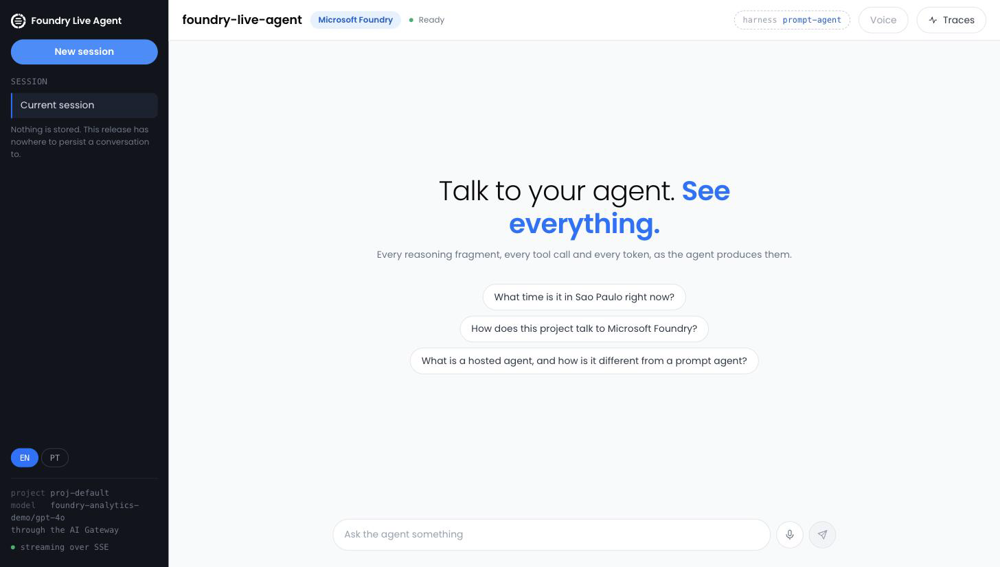
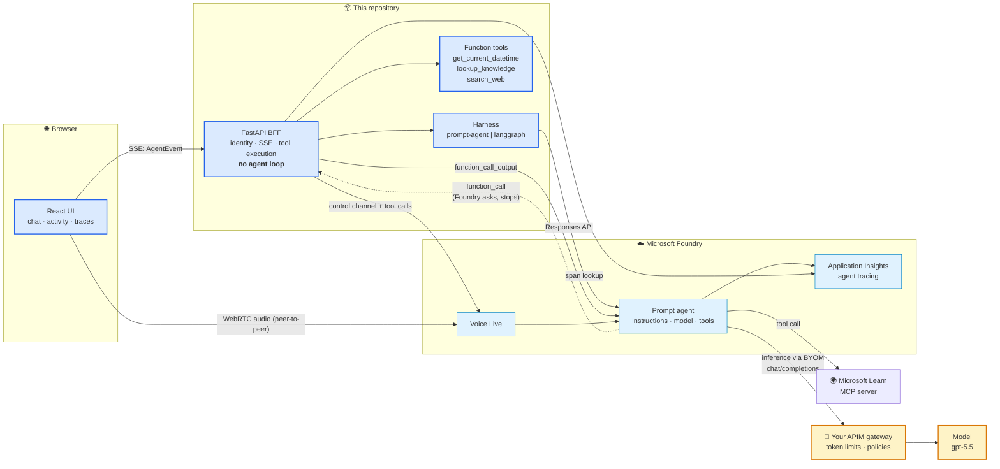
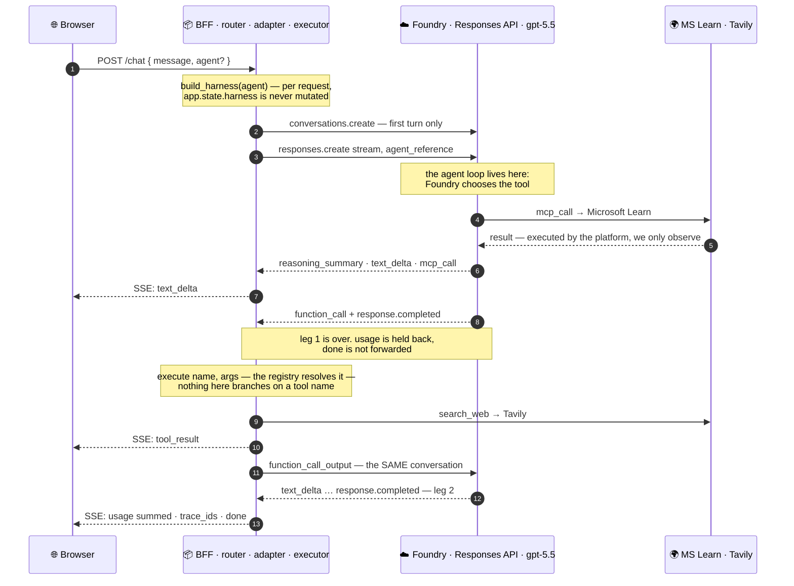
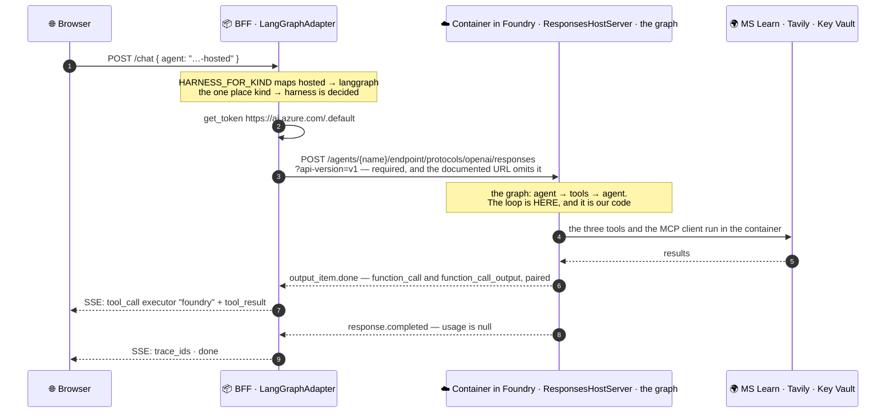
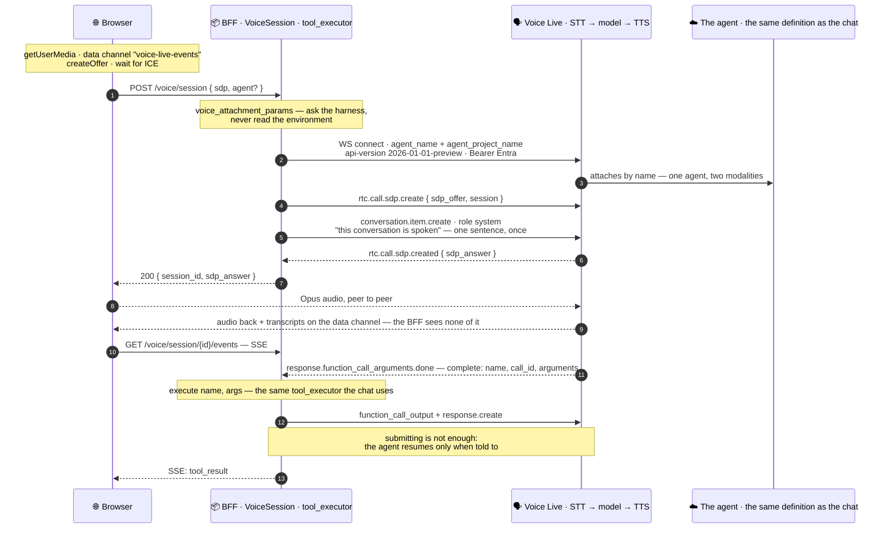
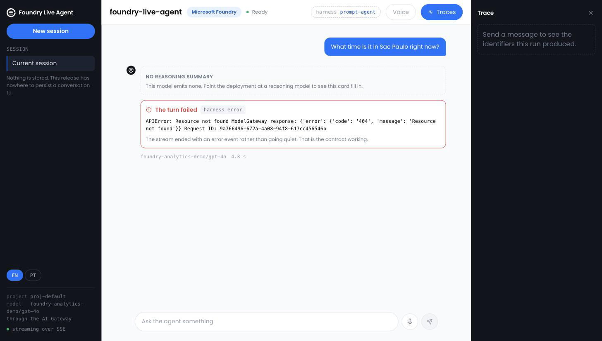
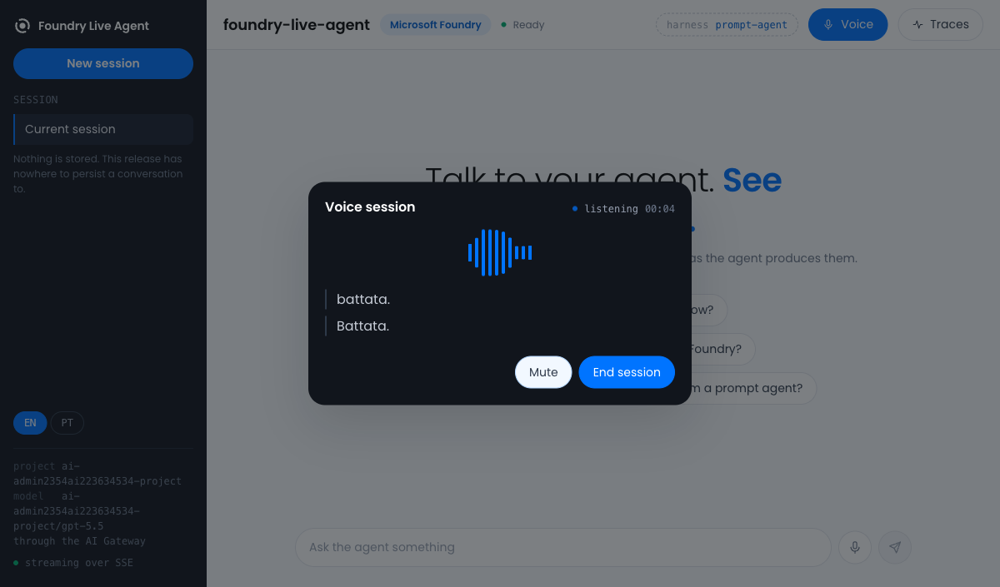

<div align="center">

# 🎙️ foundry-live-agent

### Microsoft Foundry Agent Service, end to end — with swappable agent harnesses

**The agent runs *in* Foundry. This repo is the app built *around* it.**
Streaming chat · live agent activity · distributed traces · real-time voice

<br />

[](docs/assets/screenshot-chat.png)

_A real run. The rail carries the agents you actually use and this browser's history; the header
says which harness answered; under the answer, the model, the token count and the way into its
spans._

<br />


<br />

**🌐 Language:** **English** · [Português 🇧🇷](./README.pt-BR.md)

</div>

---

> **Status: chat, voice, traces and agent selection all run.** Specs 000–019, 021 and 022 are done —
> the harness contract, **both harnesses**, the BFF, the shell, voice on the same agent, the trace
> panel and the agents screen. Spec 020 (*side by side* — one question, two agents, two streams) is
> clarified and not built yet. See [`specs/README.md`](specs/README.md); the architecture record is
> [`PLAN.md`](PLAN.md).

## 📑 Contents

1. [What this is](#-what-this-is) · 2. [Architecture](#-architecture) · 3. [Quickstart](#-quickstart-10-minutes)
4. [Screenshots](#-screenshots) · 5. [Harnesses](#-harnesses) · 6. [How we build here](#-how-we-build-here)
7. [Cost](#-cost) · 8. [Cleanup](#-cleanup)

---

## 🧭 What this is

Most agent tutorials put the agent loop in your application: your code picks the tools, calls the
model, and loops. This repository does the opposite, on purpose.

**The agent — its instructions, model and tools — lives in Microsoft Foundry.** This repo is
everything *around* it: identity, streaming, tool execution, tracing, voice and a UI. The backend is
a **BFF** with no agent-loop logic at all, and that boundary is enforced as
[constitution §8](.specify/constitution.md), not just described in prose.

That makes one thing possible which is otherwise hard: **the harness is swappable.** The same
frontend, BFF, gateway, traces and voice work whether Foundry runs the loop (a *prompt agent*) or
your container does (a *hosted agent* running LangGraph). Both sit behind one contract.

| | |
|---|---|
| 🔌 **One contract, two harnesses** | `HarnessAdapter` + a typed `AgentEvent` stream. **Both ship**: `prompt-agent` and a LangGraph container Foundry hosts. |
| 🧭 **Pick the agent from the screen** | The sidebar lists the agents that are *actually in your Foundry project* — kind, served version, status — and you choose which one answers, with no restart. Agents this build has no harness for are listed and dimmed, with the reason. |
| 🛠️ **Four tools, two owners** | Microsoft Learn MCP runs *in Foundry*; three function tools — the clock, the project's own knowledge base and live web search — run *in the BFF*, because Foundry asks and stops. One line per call in the chat, the payload in the trace panel. |
| 🔍 **Traces you can see** | An Application Insights span tree in a drawer: agent run › model calls › tool calls, with durations and tokens. |
| 🗣️ **Voice on the same agent** | Voice Live attaches to the *same* definition — one agent, one tool set, one trace store, two modalities.  The voice, the turn detector and noise suppression are configured per deployment. |
| 🔊 **Answers you can hear** | A toggle reads the chat's answers aloud, sentence by sentence as they stream, synthesised by the BFF so the browser still holds no credential. |
| 🔐 **Zero secrets** | Entra ID via `DefaultAzureCredential` everywhere. The browser never holds an Azure credential. |

## 🏗️ Architecture



**Blue = we build it. Light blue = Foundry runs it. Amber = your gateway.** Three details worth
staring at:

- The dotted line: Foundry emits a `function_call` and **stops**. If the BFF doesn't answer, the run
  hangs and expires after 10 minutes. That round trip is the point of the whole design.
- **The gateway is not where you'd guess.** It does not sit between the app and the agent — it sits
  between the *agent* and the *model*. The project-level "AI Gateway" governs direct model calls and
  does **not** carry agent inference; routing the agent through your APIM is a separate feature
  (*bring your own model*), and it changes the model's name to `<connection>/<model>`.
  **The shipped default does not take that path.** `ai/harness/_shared/agent_core.yaml` names a
  plain deployment on purpose, so inference bypasses the gateway until the APIM API is bound to its
  backend — which is also why `otel_trace_id` and `gateway_request_id` are still pending in the
  trace panel. The amber box is the design, not today's configuration.
- Voice audio goes **browser → Voice Live directly**; only the control channel (and the tool calls
  on it) touches our server. No Azure credential ever reaches the browser, and **Voice Live never
  passes through any gateway**.

Full detail: [`docs/architecture.md`](docs/architecture.md) · [`PLAN.md`](PLAN.md).

### 🔬 One turn, hop by hop

The map above says *who talks to whom*. These three say *in what order*, which is where the design
actually lives — and the difference between the two harnesses is one edge appearing and a whole leg
disappearing.

#### Prompt agent — the turn in two legs

Foundry decides which tool to call, emits the `function_call` and **stops**. The BFF executes and
answers on a second request bound to the *same* conversation.



- **Both legs must name one conversation.** The second carries only `function_call_output` items;
  unbound, Foundry answers `400 — No tool call found for function call output with call_id …`.
- **An unanswered call hangs the run for ten minutes**, and from the UI the stream simply stops.
  `check_stream` turns that silence into a loud test failure.
- **Two `response.completed` in one turn.** Usage is summed across the legs and `done` is held until
  the turn really ends, or the contract would see two terminals.

#### Hosted agent — the turn in one leg

The same agent, authored as a LangGraph graph in a container Foundry runs. Every `function_call`
arrives **already paired** with its `function_call_output`: nothing to answer, nothing to accumulate,
no loop in the adapter at all.



- **No edge comes back out of the BFF mid-turn.** That absence is the whole finding: one request is
  the entire turn, and `submit_tool_output` is structurally unreachable on this path.
- **Microsoft Learn is not an `mcp_call` here.** The container is the MCP client, so it is an
  ordinary tool call in the graph.
- **`executor` answers one question** — *who is responsible for executing and answering this?* The
  container is the platform side, even though we wrote it.
- **No checkpointer, on purpose.** With one, the state would be ours; the app would then own state
  the platform already owns, which is exactly what §8 forbids.

#### Voice — three channels, and only one touches our server

The browser makes the SDP offer; the BFF, which holds the credential, answers. From then on audio is
peer-to-peer and our server is not in the latency path of anything a person hears.



One endpoint, not three:

```
wss://<resource>.services.ai.azure.com/voice-live/realtime/calls
  ?api-version=2026-01-01-preview
  &agent_name=foundry-live-agent
  &agent_project_name=<project>
```

- **The voice you hear is Azure text to speech, not the model speaking.** Voice Live transcribes
  before the model and synthesises after it, so a spoken turn on `gpt-5.5` is a cascade — Azure STT
  → the agent → Azure TTS. Only `azure-realtime` and the `gpt-realtime*` family generate audio
  natively. STT and TTS are stages *behind* that one endpoint; the app never calls them itself.
- **The agent does not know it is speaking.** Asked over real audio it answers *"Estou trocando
  texto escrito com você."* That is why the session sends one `role: system` context item saying the
  conversation is spoken — the single bounded exception to §8, and the reason a spoken answer stops
  reading URLs out loud.
- **The parameter names contradict the quickstart.** It documents `project_name`; the service wants
  **`agent_project_name`** and reports a missing *value* rather than a wrong *key*.
- **Two api-versions, one per endpoint.** `/voice-live/realtime/calls` exists **only** on
  `2026-01-01-preview`; the plain WebSocket route works on all four. One shared value silently
  breaks whichever path it was not chosen for.

Each of these has a page of its own, with the recorded frames behind it:
[the function-call round trip](docs/how-it-works/function-call-round-trip.md) ·
[streaming events](docs/how-it-works/streaming-events.md) ·
[the Voice Live session lifecycle](docs/how-it-works/voice-live-lifecycle.md).

## 🚀 Quickstart (10 minutes)

**Prerequisites:** an Azure subscription · [Azure CLI](https://learn.microsoft.com/cli/azure/install-azure-cli) ·
[azd](https://learn.microsoft.com/azure/developer/azure-developer-cli/install-azd) ·
[just](https://github.com/casey/just) · Python 3.12 · Node 24 (Vite 8 needs ≥ 20.19; CI runs 24).

```bash
git clone https://github.com/reginaldosilva27/foundry-live-agent
cd foundry-live-agent

just env            # 1. create .env from the template
just login          # 2. az login — Entra ID; no key for any Azure service
just infra          # 3. provision Foundry — prints the manual steps; there is no IaC here yet
just agent          # 4. apply the agent definition from ai/harness/prompt_agent/agent.yaml
just backend        # 5. the BFF on :8000
just frontend       # 6. the UI on :5173
```

**Step 3 is manual, and `just infra` says so rather than pretending.** This repository ships no
Bicep: the Foundry resource, project, model deployment and Application Insights are created in the
portal or with the CLI, following the two pages recorded in
[`docs/REFERENCES.md`](docs/REFERENCES.md). Unverified IaC would be worse than an honest manual step
(constitution §5) — see [`infra/README.md`](infra/README.md).

Then ask something that forces both tool paths at once:

> *"What time is it in São Paulo, and what does the Foundry documentation say about hosted agents?"*

`get_current_datetime` runs **in the BFF**; the docs lookup runs **in Foundry** via the Learn MCP
server. Watch both land in the Agent activity panel, then open the trace drawer.

Web search is the third function tool and the one exception to "no keys": Tavily is a third-party
service with no Entra path, so set `TAVILY_API_KEY` in `.env` to enable `search_web`. Leave it empty
and the app runs fine — the agent simply says web search is not configured.

Optional — the AI Gateway is a portal flow with no IaC path: `just gateway` prints the steps.

## 📸 Screenshots

| | |
|---|---|
|  |  |
| _A terminal `error` renders as an error, not as a stream that stopped_ | _A live Voice Live session on the same agent — the transcript arrives on the WebRTC data channel_ |

The shell itself is at the top of this page. Both of these are real screenshots of real runs, and
the first is what the app shows when the Foundry
project has no model deployment behind the gateway connection yet: the round trip completed, the
gateway answered `404`, and the contract turned that into a terminal event instead of silence.

Two honest caveats (constitution §5): both shots were taken **before** the current
shell (spec 021), so the chrome around them is older than the one at the top of this page; and the
span tree — which ships, specs 005 and 014 — has no committed capture yet. That one is missing out
of neglect, not for a reason.

## 🔌 Harnesses

| | **prompt-agent** (ships) | **langgraph** (ships) |
|---|---|---|
| Who runs the loop | Foundry | Your container, hosted by Foundry |
| Agent definition | `agent.yaml` → Agent Service SDK | `azure.yaml` → `azd` |
| Who runs the function tools | The BFF — Foundry asks and stops | The container, itself |
| Who is the MCP client | Foundry | The container — so **no `mcp_call`** |
| You maintain | Nothing at runtime | Your graph, and its image |
| Best for | Getting it working, and most production agents | Custom orchestration |

Both run the **same model, the same instructions and the same four tools**, from one file
(`ai/harness/_shared/agent_core.yaml`), so what differs between them is the harness and nothing
else. Pick one from the **Agents** panel in the sidebar and the next message goes to it; a new
conversation starts, because a Foundry conversation belongs to one agent. `AGENT_HARNESS` and
`AGENT_NAME` still decide who answers before anyone chooses — they are the default, not the law.

The panel lists the whole project, so it will also show agents this repo did not write. A **prompt**
agent you did not write is selectable, because the prompt harness drives any prompt agent by name —
choosing one produces a working conversation with a different agent, which is what it says on the
row.

What it costs to run each one, measured rather than documented:
[`docs/harness-comparison.md`](docs/harness-comparison.md).

## 🧪 How we build here

Spec-first, test-first, gates green — inherited from
[agentic-coding-template](https://github.com/reginaldosilva27/agentic-coding-template).

```
spec.md ──clarify──> plan.md ──> tasks.md ──TDD──> code + tests ──> gates green
```

```bash
just verify         # everything CI runs; a layer with no code yet skips clean
```

Three project-specific laws, enforced at review ([the constitution](.specify/constitution.md)):

- **§8** — no agent-loop logic in `backend/` or `frontend/`, ever.
- **§9** — the `AgentEvent` set is the contract; changing it needs a spec.
- **§10** — **no Foundry API written from memory.** Foundry changed substantially through 2026;
  every SDK version, endpoint, `api-version` and event name is cited in
  [`docs/REFERENCES.md`](docs/REFERENCES.md) with the URL it came from.

New here? [`CONTRIBUTING.md`](CONTRIBUTING.md) and [`docs/development-workflow.md`](docs/development-workflow.md).

## 💰 Cost

Everything is consumption-based; an evaluation session costs a few dollars, but **the two things that
bill while you are not looking are the gateway and the workspace.**

| Resource | How it bills | Watch out |
|---|---|---|
| Model inference | Per token | Reasoning models emit reasoning tokens you pay for |
| Voice Live | Tiered by model (pro/basic/lite), ~10 tok/s in, ~20 tok/s out | Charged per audio second — don't leave a session open |
| **APIM gateway** | **Per hour (v2 tiers)** | **Bills whether or not you send traffic.** Delete it if `azd` created it; leave it if it was already yours. |
| Application Insights | Per GB ingested + retention | Traces capture prompts and tool arguments |
| Foundry resource/project | No standing charge | — |

Set per-project token limits on the gateway (over TPM → `429`, over quota → `403`) so a runaway loop
cannot run up a bill.

## 🧹 Cleanup

```bash
just down           # azd down — removes the resource group
```

`azd down` does **not** remove the APIM instance behind the AI Gateway if you created it through the
portal. Delete it separately in the Azure portal, or it keeps billing.

---

<div align="center">

**MIT** © [Reginaldo Silva](https://github.com/reginaldosilva27) — Data Engineer / AI Engineer, Microsoft MVP

Built as a reference and as teaching material. Issues and PRs welcome.

</div>
