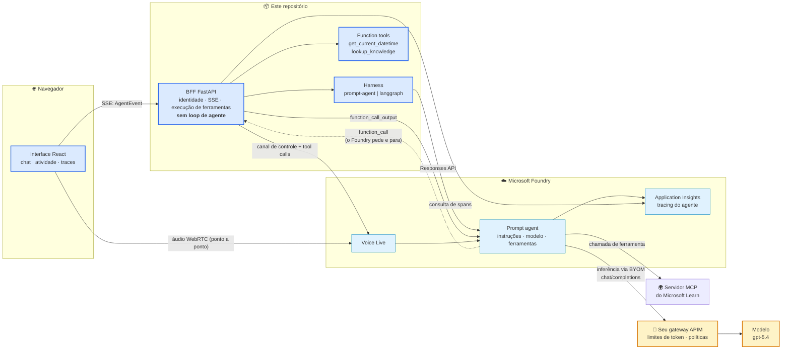

<div align="center">

# 🎙️ foundry-live-agent

### Microsoft Foundry Agent Service, ponta a ponta — com harnesses de agente intercambiáveis

**O agente roda *dentro* do Foundry. Este repositório é a aplicação construída *ao redor* dele.**
Chat com streaming · atividade do agente ao vivo · traces distribuídos · voz em tempo real

<br />


<br />

**🌐 Idioma:** [English](./README.md) · **Português 🇧🇷**

</div>

---

> **Status: chat e voz funcionando.** As specs 000–004 e 006 estão concluídas — o contrato do
> harness, o prompt agent, o BFF, a interface e a **voz no mesmo agente**. Falta a 005 (o painel de
> rastros). Veja [`specs/README.md`](specs/README.md); o registro de arquitetura é o
> [`PLAN.md`](PLAN.md).

## 📑 Conteúdo

1. [O que é isto](#-o-que-é-isto) · 2. [Arquitetura](#️-arquitetura) · 3. [Início rápido](#-início-rápido-10-minutos)
4. [Telas](#-telas) · 5. [Harnesses](#-harnesses) · 6. [Como construímos aqui](#-como-construímos-aqui)
7. [Custo](#-custo) · 8. [Limpeza](#-limpeza)

---

## 🧭 O que é isto

A maioria dos tutoriais de agente coloca o loop do agente dentro da sua aplicação: seu código escolhe
as ferramentas, chama o modelo e faz o loop. Este repositório faz o contrário, de propósito.

**O agente — instruções, modelo e ferramentas — vive no Microsoft Foundry.** Este repositório é tudo
que está *ao redor*: identidade, streaming, execução de ferramentas, tracing, voz e a interface. O
backend é um **BFF** sem nenhuma lógica de loop de agente, e essa fronteira é obrigatória por força da
[§8 da constituição](.specify/constitution.md) — não é só uma intenção escrita em prosa.

Isso viabiliza algo que normalmente é difícil: **o harness é intercambiável.** O mesmo frontend, BFF,
gateway, traces e voz funcionam tanto se o Foundry roda o loop (*prompt agent*) quanto se o seu
contêiner roda (*hosted agent* com LangGraph). Os dois ficam atrás de um único contrato.

| | |
|---|---|
| 🔌 **Um contrato, dois harnesses** | `HarnessAdapter` + um stream tipado de `AgentEvent`. O `prompt-agent` está pronto; o `langgraph` é scaffold. |
| 🛠️ **Três ferramentas, dois donos** | O MCP do Microsoft Learn roda *no Foundry*; duas function tools rodam *no BFF* — porque o Foundry pede e para. |
| 🔍 **Traces visíveis** | Uma árvore de spans do Application Insights numa gaveta: execução do agente › chamadas de modelo › chamadas de ferramenta, com durações e tokens. |
| 🗣️ **Voz no mesmo agente** | O Voice Live se conecta à *mesma* definição — um agente, um conjunto de ferramentas, um repositório de traces, duas modalidades. |
| 🔊 **Respostas que dá para ouvir** | Um botão lê as respostas do chat em voz alta, frase a frase conforme elas chegam, sintetizadas pelo BFF — o navegador continua sem credencial. |
| 🔐 **Zero segredos** | Entra ID via `DefaultAzureCredential` em tudo. O navegador nunca guarda credencial do Azure. |

## 🏗️ Arquitetura



**Azul = nós construímos. Azul claro = o Foundry executa. Âmbar = o seu gateway.** Três detalhes que
merecem atenção:

- A linha pontilhada: o Foundry emite um `function_call` e **para**. Se o BFF não responder, a
  execução trava e expira em 10 minutos. Esse ida-e-volta é o ponto central de todo o desenho.
- **O gateway não fica onde você imaginaria.** Ele não fica entre a aplicação e o agente — fica entre
  o *agente* e o *modelo*. O "AI Gateway" de projeto governa chamadas diretas de modelo e **não**
  carrega a inferência do agente; rotear o agente pelo seu APIM é outro recurso (*bring your own
  model*), e ele muda o nome do modelo para `<conexão>/<modelo>`.
- O áudio da voz vai **do navegador direto para o Voice Live**; só o canal de controle (e as chamadas
  de ferramenta nele) passa pelo nosso servidor. Nenhuma credencial do Azure chega ao navegador, e o
  **Voice Live nunca passa por gateway nenhum**.

Detalhes completos: [`docs/architecture.md`](docs/architecture.md) · [`PLAN.md`](PLAN.md).

## 🚀 Início rápido (10 minutos)

**Pré-requisitos:** uma assinatura Azure · [Azure CLI](https://learn.microsoft.com/cli/azure/install-azure-cli) ·
[azd](https://learn.microsoft.com/azure/developer/azure-developer-cli/install-azd) ·
[just](https://github.com/casey/just) · Python 3.12 · Node 20.

```bash
git clone https://github.com/reginaldosilva27/foundry-live-agent
cd foundry-live-agent

just env            # 1. cria o .env a partir do template
just login          # 2. az login — Entra ID, sem API key em lugar nenhum
just infra          # 3. azd up: recurso Foundry, projeto, modelo, App Insights (~5 min)
just agent          # 4. aplica a definição do agente de ai/harness/prompt-agent/agent.yaml
just backend        # 5. o BFF na :8000
just frontend       # 6. a interface na :5173
```

Depois pergunte algo que force os dois caminhos de ferramenta ao mesmo tempo:

> *"Que horas são em São Paulo, e o que a documentação do Foundry diz sobre hosted agents?"*

O `get_current_datetime` roda **no BFF**; a busca na documentação roda **no Foundry** via o servidor
MCP do Learn. Veja os dois aparecerem no painel de atividade e depois abra a gaveta de traces.

Opcional — o AI Gateway é um fluxo de portal sem caminho de IaC: `just gateway` imprime os passos.

## 📸 Telas

| | |
|---|---|
|  |  |
| _A casca de três painéis, com o selo do harness no cabeçalho_ | _Um `error` terminal aparece como erro, não como um stream que parou_ |
|  | |
| _Uma sessão do Voice Live ao vivo no mesmo agente — a transcrição chega pelo data channel do WebRTC_ | |

As duas são capturas reais de uma execução real. A segunda mostra o que o app exibe quando o projeto
do Foundry ainda não tem um model deployment atrás da conexão do gateway: o round trip completou, o
gateway respondeu `404`, e o contrato transformou isso em um evento terminal em vez de silêncio.

Falta uma tela, e ela falta por um motivo, não por descuido (constituição §5):

| Falta | Depende de |
|---|---|
| `screenshot-traces.png` — a árvore de spans com durações | Spec 005 |

## 🔌 Harnesses

| | **prompt-agent** (pronto) | **langgraph** (planejado) |
|---|---|---|
| Quem roda o loop | O Foundry | Seu contêiner, hospedado pelo Foundry |
| Definição do agente | `agent.yaml` → SDK do Agent Service | `azure.yaml` → `azd` |
| Ferramentas | Declaradas no agente | Declaradas na chamada Responses / num Toolbox |
| Você mantém | Nada em runtime | Seu grafo |
| Melhor para | Colocar de pé, e a maioria dos agentes em produção | Orquestração customizada |

`AGENT_HARNESS=prompt-agent|langgraph` alterna entre eles; o selo no painel de configurações mostra
qual está ativo. O `langgraph` é um **scaffold documentado** — ele levanta `NotImplementedError` em
vez de fingir que funciona. Trade-offs: [`docs/harness-comparison.md`](docs/harness-comparison.md).

## 🧪 Como construímos aqui

Spec primeiro, teste primeiro, gates verdes — herdado do
[agentic-coding-template](https://github.com/reginaldosilva27/agentic-coding-template).

```
spec.md ──clarify──> plan.md ──> tasks.md ──TDD──> código + testes ──> gates verdes
```

```bash
just verify         # tudo que o CI roda; camada sem código ainda é pulada de forma limpa
```

Três leis específicas deste projeto, cobradas na revisão ([a constituição](.specify/constitution.md)):

- **§8** — nunca lógica de loop de agente em `backend/` ou `frontend/`.
- **§9** — o conjunto `AgentEvent` é o contrato; mudá-lo exige uma spec.
- **§10** — **nenhuma API do Foundry escrita de memória.** O Foundry mudou muito ao longo de 2026;
  cada versão de SDK, endpoint, `api-version` e nome de evento está citado em
  [`docs/REFERENCES.md`](docs/REFERENCES.md) com a URL de onde veio.

Chegou agora? [`CONTRIBUTING.md`](CONTRIBUTING.md) e [`docs/development-workflow.md`](docs/development-workflow.md).

## 💰 Custo

Tudo é por consumo; uma sessão de avaliação custa poucos dólares, mas **as duas coisas que cobram
enquanto você não está olhando são o gateway e o workspace.**

| Recurso | Como cobra | Atenção |
|---|---|---|
| Inferência de modelo | Por token | Modelos de raciocínio emitem reasoning tokens que você paga |
| Voice Live | Por faixa do modelo (pro/basic/lite), ~10 tok/s entrada, ~20 tok/s saída | Cobra por segundo de áudio — não deixe sessão aberta |
| **Gateway APIM** | **Por hora (tiers v2)** | **Cobra mesmo sem tráfego.** Delete se foi o `azd` que criou; mantenha se já era seu. |
| Application Insights | Por GB ingerido + retenção | Traces capturam prompts e argumentos de ferramentas |
| Recurso/projeto Foundry | Sem cobrança fixa | — |

Configure limites de token por projeto no gateway (acima do TPM → `429`, acima da cota → `403`) para
que um loop descontrolado não gere uma fatura inesperada.

## 🧹 Limpeza

```bash
just down           # azd down — remove o resource group
```

O `azd down` **não** remove a instância do APIM por trás do AI Gateway se você a criou pelo portal.
Delete separadamente no portal do Azure, ou ela continua cobrando.

---

<div align="center">

**MIT** © [Reginaldo Silva](https://github.com/reginaldosilva27) — Data Engineer / AI Engineer, Microsoft MVP

Feito como referência e como material didático. Issues e PRs são bem-vindos.

</div>
