<div align="center">

# 🎙️ foundry-live-agent

### Microsoft Foundry Agent Service, ponta a ponta — com harnesses de agente intercambiáveis

**O agente roda *dentro* do Foundry. Este repositório é a aplicação construída *ao redor* dele.**
Chat com streaming · atividade do agente ao vivo · traces distribuídos · voz em tempo real

<br />

[](docs/assets/screenshot-chat.png)

_Um turno inteiro. As duas linhas marcadas `bff` são function tools que **esta aplicação** executou
porque o Foundry pediu e parou; as duas marcadas `microsoft_learn` rodaram **dentro do Foundry**.
Essa divisão é a arquitetura, na tela. Capturado com `just demo` — por isso a faixa de reprodução
aparece: todo print desta página você reproduz sem conta no Azure._

<br />


<br />

**🌐 Idioma:** [English](./README.md) · **Português 🇧🇷**

</div>

---

> **Status: veja o [índice de specs](specs/README.md).** O contrato do harness, **os dois harnesses**, o BFF,
> a interface, a voz no mesmo agente, o painel de traces, a tela de agentes e tudo que veio em cima
> disso — escolha e inspeção de agente, lado a lado, traces, o inspetor de eventos, gráficos, temas
> e a passada de acessibilidade. Duas não: a **045** (*anexos*) está clarificada e **bloqueada** em
> uma decisão de retenção que é do operador, não de um documento; a **049** (*Foundry IQ como fonte
> de conhecimento*) está planejada.
>
> **Qual spec está onde mora num lugar só — [`specs/README.md`](specs/README.md)** — porque duas
> tabelas de cinquenta linhas divergem, e esta divergiu. O registro de arquitetura é o
> [`PLAN.md`](PLAN.md).

## 📑 Conteúdo

1. [O que é isto](#-o-que-é-isto) · 2. [Arquitetura](#️-arquitetura) · 3. [Veja funcionando primeiro](#️-veja-funcionando-primeiro--sem-azure-nenhum)
4. [Início rápido](#-início-rápido) · 5. [Telas](#-telas) · 6. [Harnesses](#-harnesses)
7. [Como construímos aqui](#-como-construímos-aqui) · 8. [Custo](#-custo) · 9. [Limpeza](#-limpeza)

---

## 🧭 O que é isto

A maioria dos tutoriais de agente coloca o loop do agente dentro da sua aplicação: seu código escolhe
as ferramentas, chama o modelo e faz o loop. Este repositório faz o contrário, de propósito.

**O agente — instruções, modelo e ferramentas — vive no Microsoft Foundry.** Este repositório é tudo
que está *ao redor*: identidade, streaming, execução de ferramentas, tracing, voz e a interface. O
backend é um **BFF** sem nenhuma lógica de loop de agente, e essa fronteira é obrigatória por força da
[§8 da constituição](.specify/constitution.md) — não é só uma intenção escrita em prosa.

Isso viabiliza algo que normalmente é difícil: **o harness é intercambiável.** O mesmo frontend, BFF,
gateway, traces e voz funcionam tanto se o Foundry roda o loop (*prompt agent*) quanto se o seu
contêiner roda (*hosted agent* com LangGraph). Os dois ficam atrás de um único contrato.

| | |
|---|---|
| 🔌 **Um contrato, dois harnesses** | `HarnessAdapter` + um stream tipado de `AgentEvent`. **Os dois estão prontos**: o `prompt-agent` e um contêiner LangGraph hospedado pelo Foundry. |
| 🧭 **Escolha o agente pela tela** | A barra lateral lista os agentes que estão *de fato no seu projeto Foundry* — tipo, versão publicada, status — e você escolhe quem responde, sem reiniciar nada. Agentes para os quais esta build não tem harness aparecem na lista, desabilitados e com o motivo. |
| 🛠️ **Quatro ferramentas, dois donos** | O MCP do Microsoft Learn roda *no Foundry*; três function tools — o relógio, a base de conhecimento do próprio projeto e a busca na internet — rodam *no BFF*, porque o Foundry pede e para. Uma linha por chamada no chat, o payload no painel de rastros. |
| 🔍 **Traces visíveis** | Uma árvore de spans do Application Insights numa gaveta: execução do agente › chamadas de modelo › chamadas de ferramenta, com durações e tokens. |
| 🗣️ **Voz no mesmo agente** | O Voice Live se conecta à *mesma* definição — um agente, um conjunto de ferramentas, um repositório de traces, duas modalidades.  A voz, o detector de turno e a supressão de ruído são configurados por implantação. |
| 🔊 **Respostas que dá para ouvir** | Um botão lê as respostas do chat em voz alta, frase a frase conforme elas chegam, sintetizadas pelo BFF — o navegador continua sem credencial. |
| 🔐 **Zero segredos** | Entra ID via `DefaultAzureCredential` em tudo. O navegador nunca guarda credencial do Azure. |

## 🏗️ Arquitetura

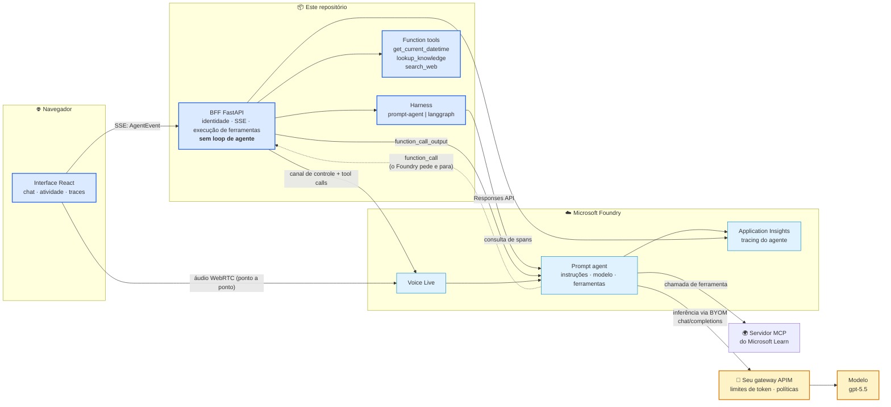

**Azul = nós construímos. Azul claro = o Foundry executa. Âmbar = o seu gateway.** Três detalhes que
merecem atenção:

- A linha pontilhada: o Foundry emite um `function_call` e **para**. Se o BFF não responder, a
  execução trava e expira em 10 minutos. Esse ida-e-volta é o ponto central de todo o desenho.
- **O gateway não fica onde você imaginaria.** Ele não fica entre a aplicação e o agente — fica entre
  o *agente* e o *modelo*. O "AI Gateway" de projeto governa chamadas diretas de modelo e **não**
  carrega a inferência do agente; rotear o agente pelo seu APIM é outro recurso (*bring your own
  model*), e ele muda o nome do modelo para `<conexão>/<modelo>`.
  **O padrão entregue não segue esse caminho.** O `ai/harness/_shared/agent_core.yaml` nomeia um
  deployment simples de propósito, então a inferência passa ao largo do gateway enquanto a API do
  APIM não estiver ligada ao seu backend — que é também por que `otel_trace_id` e
  `gateway_request_id` continuam pendentes no painel de trace. A caixa âmbar é o desenho, não a
  configuração de hoje.
- O áudio da voz vai **do navegador direto para o Voice Live**; só o canal de controle (e as chamadas
  de ferramenta nele) passa pelo nosso servidor. Nenhuma credencial do Azure chega ao navegador, e o
  **Voice Live nunca passa por gateway nenhum**.

Detalhes completos: [`docs/architecture.md`](docs/architecture.md) · [`PLAN.md`](PLAN.md).

### 🔬 Um turno, hop a hop

O mapa acima diz *quem fala com quem*. Os três desenhos abaixo dizem *em que ordem* — que é onde o
desenho de fato mora. A diferença entre os dois harnesses é uma aresta que aparece e uma perna
inteira que some.

#### Prompt agent — o turno em duas pernas

O Foundry decide qual ferramenta chamar, emite o `function_call` e **para**. O BFF executa e
responde numa segunda requisição amarrada à *mesma* conversa.

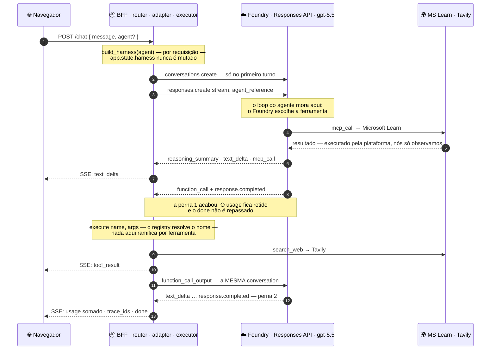

- **As duas pernas precisam citar uma só conversa.** A segunda leva apenas itens
  `function_call_output`; sem amarração, o Foundry responde
  `400 — No tool call found for function call output with call_id …`.
- **Uma chamada sem resposta trava a execução por dez minutos**, e da interface o stream
  simplesmente para. O `check_stream` transforma esse silêncio em falha barulhenta de teste.
- **Uma ida e volta de função tem dois `response.completed`; mais rodadas acrescentam outros.** O usage é somado entre as pernas e o `done` fica
  retido até o turno acabar de verdade — senão o contrato veria dois terminais.

#### Hosted agent — o turno numa perna só

O mesmo agente, autorado como um grafo LangGraph num container que o Foundry executa. Todo
`function_call` chega **já pareado** com o seu `function_call_output`: nada a responder, nada a
acumular, nenhum loop no adapter.

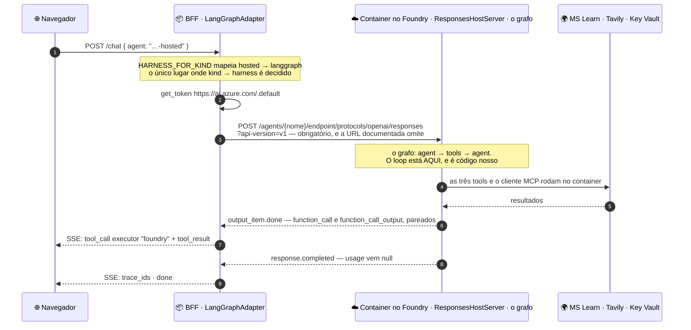

- **Nenhuma aresta sai do BFF no meio do turno.** Essa ausência é a descoberta inteira: uma
  requisição é o turno completo, e `submit_tool_output` é estruturalmente inalcançável aqui.
- **O Microsoft Learn não é um `mcp_call` neste caminho.** O cliente MCP é o container, então a
  chamada é uma tool call comum do grafo.
- **O `executor` responde a uma pergunta só** — *quem é responsável por executar e responder isto?*
  O container é o lado da plataforma, mesmo sendo código nosso.
- **Sem checkpointer no grafo atual.** Encaminhar um ponteiro de conversa não prova continuidade
  hosted multi-turn. Um agente implantado no Foundry pode ter sua orquestração/estado; a §8 proíbe
  duplicar essa propriedade no BFF/navegador, não autorar um hosted agent.

#### Voz — três canais, e só um passa pelo nosso servidor

O navegador faz a oferta SDP; o BFF, que tem a credencial, responde. Dali em diante o áudio é ponto
a ponto, e o nosso servidor não está no caminho de latência de nada que a pessoa ouve.

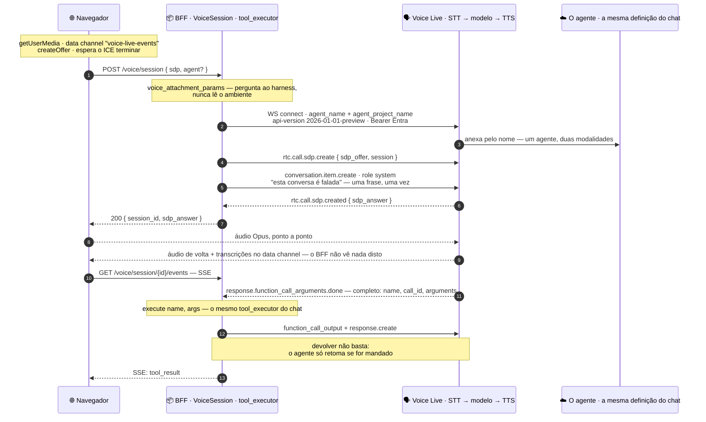

Um endpoint, não três:

```
wss://<recurso>.services.ai.azure.com/voice-live/realtime/calls
  ?api-version=2026-01-01-preview
  &agent_name=foundry-live-agent
  &agent_project_name=<projeto>
```

- **A voz que você ouve é text to speech do Azure, não o modelo falando.** O Voice Live transcreve
  antes do modelo e sintetiza depois dele, então um turno falado no `gpt-5.5` é uma cascata — STT do
  Azure → o agente → TTS do Azure. Só o `azure-realtime` e a família `gpt-realtime*` geram áudio
  nativamente. STT e TTS são estágios *atrás* daquele único endpoint; a aplicação nunca os chama.
- **O agente não sabe que está falando.** Perguntado ao vivo, ele responde *"Estou trocando texto
  escrito com você."* Por isso a sessão manda um item de contexto `role: system` dizendo que a
  conversa é falada — a única exceção limitada ao §8, e o motivo de a resposta falada parar de ler
  URLs em voz alta.
- **Os nomes dos parâmetros contrariam o quickstart.** Ele documenta `project_name`; o serviço quer
  **`agent_project_name`** e reclama de um *valor* faltando, não de uma *chave* errada.
- **Duas api-versions, uma por endpoint.** A rota `/voice-live/realtime/calls` existe **só** em
  `2026-01-01-preview`; a rota WebSocket simples funciona nas quatro. Um valor compartilhado quebra
  silenciosamente o caminho que não foi escolhido.

Cada um destes tem uma página própria, com os frames gravados por trás:
[o ida-e-volta de function call](docs/how-it-works/function-call-round-trip.md) ·
[eventos de streaming](docs/how-it-works/streaming-events.md) ·
[o ciclo de vida da sessão Voice Live](docs/how-it-works/voice-live-lifecycle.md).

## ▶️ Veja funcionando primeiro — sem Azure nenhum

Este é um laboratório **educacional, não de produção**. O replay não exige assinatura,
Azure CLI, login nem `.env`. Instale [Python 3.12](https://www.python.org/downloads/),
[Node 24 LTS](https://nodejs.org/) (as versões do CI) e [just](https://github.com/casey/just).
Os comandos abaixo são para macOS/Linux com Bash; no Windows use WSL2.
A instalação baixa pacotes; depois o replay não chama Azure nem Tavily.

```bash
git clone https://github.com/reginaldosilva27/foundry-live-agent
cd foundry-live-agent
python3.12 -m venv .venv
source .venv/bin/activate
python -m pip install -e "ai[dev]" -e "backend[dev]"
(cd frontend && npm ci)
just demo           # o BFF na :8000, a interface na :5173
```

Abra **http://localhost:5173**; a API responde em **http://localhost:8000/health**.
Mantenha o terminal aberto. **Ctrl+C** encerra os dois servidores locais, não recursos Azure.
Em um terminal novo, rode `source .venv/bin/activate` antes dos comandos Python/just. Siga a
[trilha de aprendizado](docs/learning-journey.pt-BR.md) ([English](docs/learning-journey.md))
do replay até tools, harnesses, eventos/traces e voz.

**Problemas comuns:** `uvicorn: command not found` ou `ModuleNotFoundError` → ative a venv e
repita a instalação dos dois pacotes; Vite ausente → rode `(cd frontend && npm ci)`; erro de
versão Node → use Node 24; porta ocupada → encerre o servidor que você iniciou naquela porta
ou use `BACKEND_PORT=8001 VITE_BFF_URL=http://localhost:8001 just demo` (mantenha a interface
na :5173, conforme as origens CORS configuradas).
Não encerre processos de outras pessoas.

Ele reproduz turnos inteiros **gravados de execuções reais no Foundry** — as mesmas fixtures que os
testes de contrato usam — então o streaming, a ida e volta do function call, as chamadas MCP, a
contagem de tokens, a árvore de spans e o inspetor de eventos são todos de verdade, chegando pelo
normalizador de verdade. Escolha qual turno gravado assistir pelo ícone de informação no cabeçalho. Um pequeno indicador
Replay permanece visível; o painel reúne data e explicação da gravação, modelo, gateway e SSE.
A entrada de voz fica no compositor do chat, não no cabeçalho (spec 059).

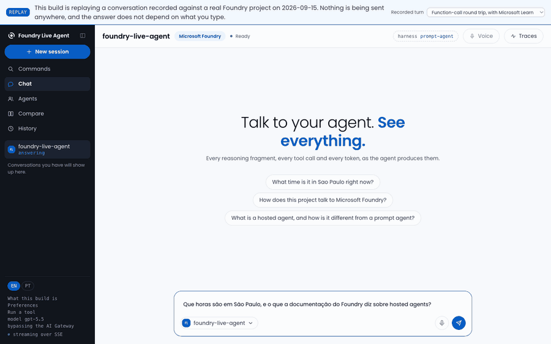

_Um turno, reproduzido. O resumo do raciocínio chega primeiro, depois as duas function calls que
esta aplicação executa e as duas chamadas ao Microsoft Learn que o Foundry executa, e então a
resposta. Nada aqui é mock: são os 310 eventos que o Foundry enviou em 2026-09-15, passando pelo
mesmo normalizador do caminho ao vivo. Um pouco mais lento para dar para ler._

**Ele não consegue responder a uma pergunta**, e diz isso em todas as telas em vez de deixar você
descobrir digitando duas vezes. Voz e fala reportam *não configurado*, porque é o que são. A
demonstração é um **entrypoint separado**: o `create_app` nunca ouviu falar dela, então nenhuma
variável de ambiente faz um deploy real servir uma gravação como se fosse ao vivo. Veja
[`specs/050-demo-mode/`](specs/050-demo-mode/).

O playground do replay executa relógio e conhecimento local, mas `search_web` sempre retorna
`search_unavailable`, mesmo com `TAVILY_API_KEY` herdada. Voz/fala e promoção de versões ficam
desabilitadas. Para a aula opcional com busca **ao vivo e tarifada**, use o caminho separado
`just backend` abaixo e habilite `FOUNDRY_ALLOW_PLAYGROUND=true` conscientemente; nunca é uma
opção implícita do replay. Veja [spec 051](specs/051-replay-isolation/spec.md).

## 🚀 Início rápido

**Pré-requisitos:** uma assinatura Azure · [Azure CLI](https://learn.microsoft.com/cli/azure/install-azure-cli) ·
[azd](https://learn.microsoft.com/azure/developer/azure-developer-cli/install-azd) ·
[just](https://github.com/casey/just) · Python 3.12 · Node 24 LTS (as versões validadas pelo CI).

Primeiro conclua a instalação da seção anterior. Este caminho usa serviços reais e pode gerar
custos. O provisionamento é manual; o tempo depende de acesso, cota e configuração de recursos,
não de uma duração fixa de início rápido. Ative a venv; depois:

```bash
just env            # 1. cria o .env a partir do template
just login          # 2. az login — Entra ID; nenhum serviço Azure usa key
just infra          # 3. provisiona o Foundry — imprime os passos manuais; ainda não há IaC aqui
just agent          # 4. aplica a definição do agente de ai/harness/prompt_agent/agent.yaml
just backend        # 5. o BFF na :8000
just frontend       # 6. a interface na :5173
```

`just backend` e `just frontend` são servidores bloqueantes: use **dois terminais**, ative
a mesma venv em ambos e encerre cada um com **Ctrl+C**. Após provisionar, preencha `.env`
com os endpoints/nomes reais antes de `just agent`; criar o arquivo não configura o Foundry.

**O passo 3 é manual, e o `just infra` diz isso em vez de fingir.** Este repositório não entrega
Bicep: o recurso Foundry, o projeto, o deployment do modelo e o Application Insights são criados no
portal ou pela CLI, seguindo as duas páginas registradas em
[`docs/REFERENCES.md`](docs/REFERENCES.md). IaC não verificado seria pior que um passo manual
honesto (constituição §5) — veja [`infra/README.md`](infra/README.md).

Depois pergunte algo que force os dois caminhos de ferramenta ao mesmo tempo:

> *"Que horas são em São Paulo, e o que a documentação do Foundry diz sobre hosted agents?"*

O `get_current_datetime` roda **no BFF**; a busca na documentação roda **no Foundry** via o servidor
MCP do Learn. Veja os dois aparecerem no painel de atividade e depois abra a gaveta de traces.

A busca na internet é a terceira function tool e a única exceção ao "sem keys": a Tavily é um serviço
de terceiros sem caminho pelo Entra, então defina `TAVILY_API_KEY` no `.env` para habilitar o
`search_web`. Deixe vazio e a aplicação roda normalmente — o agente apenas avisa que a busca na
internet não está configurada.

Opcional — o AI Gateway é um fluxo de portal sem caminho de IaC: `just gateway` imprime os passos.

## 📸 Telas

Todos os prints abaixo saem do `just demo`, nas larguras indicadas — então cada um é algo que você
coloca na sua própria tela em cerca de um minuto, sem conta no Azure. A faixa dessas capturas históricas faz parte daquela build; não é mock.
A interface atual mantém um pequeno indicador Replay e reúne os detalhes no ícone de informação (spec 059).

| | |
|---|---|
| [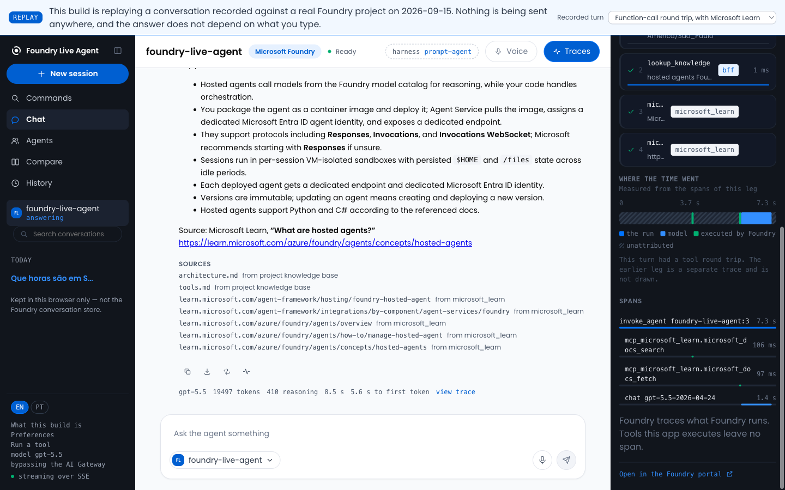](docs/assets/screenshot-trace.png) | [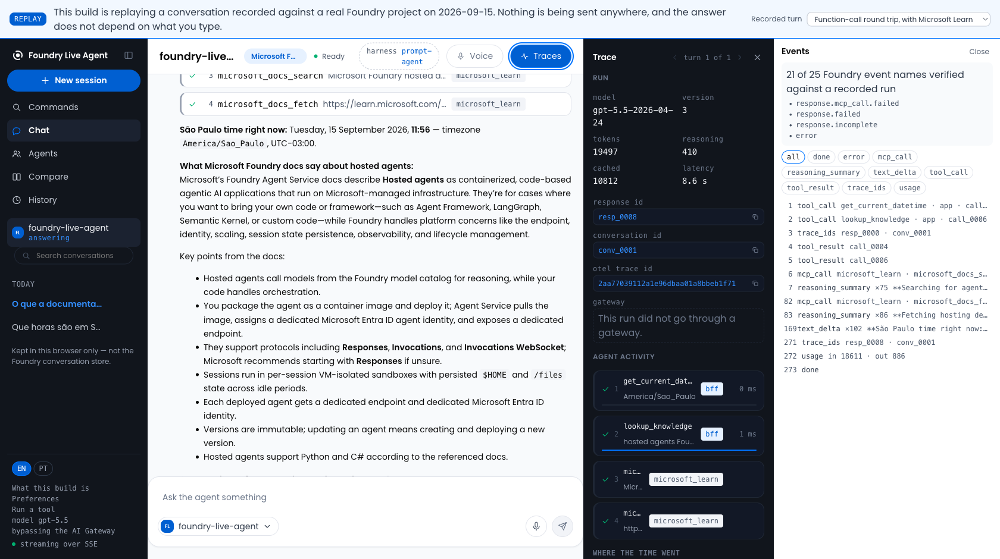](docs/assets/screenshot-events.png) |
| **A gaveta de trace** (specs 005, 014). `invoke_agent` sobre duas chamadas MCP do Learn e a chamada de modelo, com durações reais — e a linha que importa: *"O Foundry rastreia o que o Foundry executa. Ferramentas que esta aplicação executa não deixam span."* É a §8 aparecendo na telemetria. | **O inspetor de eventos** (spec 038), a 1680px, onde ele ganha uma coluna própria. Todos os eventos SSE normalizados do BFF no turno, filtrados por tipo, com o relatório de honestidade do próprio contrato acima: *21 de 25 nomes de evento do Foundry verificados contra uma execução gravada.* |
| [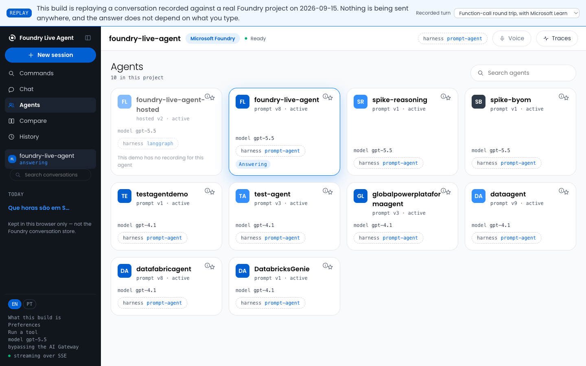](docs/assets/screenshot-agents.png) | [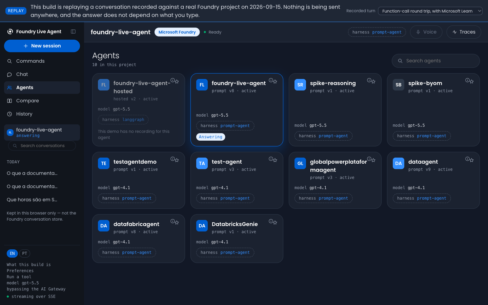](docs/assets/screenshot-dark.png) |
| **A tela de agentes** (specs 019, 030). Dez agentes de um projeto Foundry real — oito deles este repositório não escreveu. O card desabilitado não é escondido: ele diz, no idioma de quem lê, *por que* não pode responder. | **Dois temas** (spec 036). Claro é a base, escuro é uma escolha explícita, e `system` remove o atributo em vez de escrever um. Todo literal de cor mora na paleta vendorizada; o `app.css` nomeia tokens e um teste garante isso. |
| [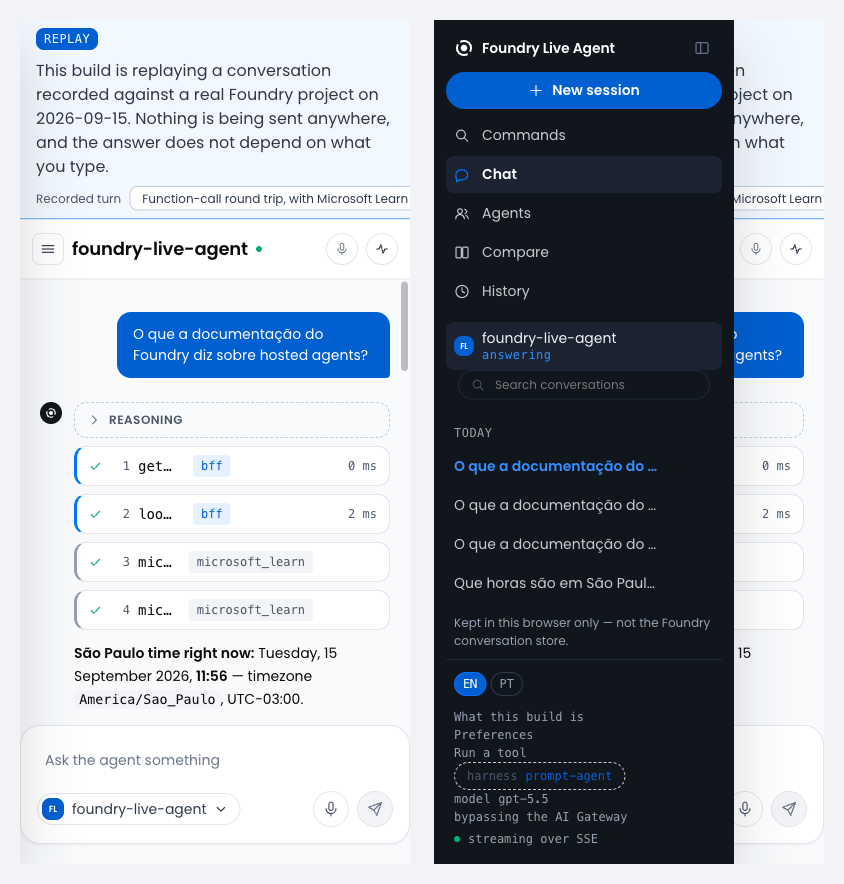](docs/assets/screenshot-narrow.png) | [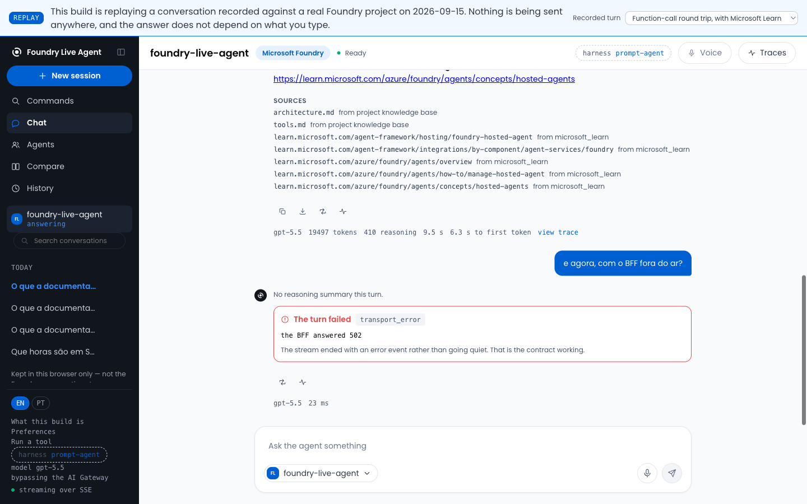](docs/assets/screenshot-error.png) |
| **390px** (spec 047). A barra nunca é escondida — abaixo de 760px ela vem **por cima** da conversa, porque `display: none` também tira o controle da árvore de acessibilidade, e essa barra é o único caminho para cinco das sete telas. | **Um turno que falhou** (spec 003). O BFF foi derrubado no meio da sessão de propósito. Um turno sempre termina em `done` ou `error` e nunca simplesmente emudece — a promessa da §9, renderizada. |

<details>
<summary>E um print mais antigo que os outros, de propósito</summary>

[](docs/assets/screenshot-voice.png)

_Uma sessão do Voice Live ao vivo no mesmo agente — a transcrição chega pelo data channel do WebRTC._

**Este é anterior à interface atual**, e é o único. Uma sessão do Voice Live é uma negociação ao vivo
com um serviço ao vivo: o `just demo` reporta voz como *não configurada*, porque naquela build ela é,
e reproduzir uma sessão WebRTC seria o desenho de um recurso em vez do recurso (constituição §5).
Recapturar exige um deployment.

</details>

## 🔌 Harnesses

| | **prompt-agent** (pronto) | **langgraph** (pronto) |
|---|---|---|
| Quem roda o loop | O Foundry | Seu contêiner, hospedado pelo Foundry |
| Definição do agente | `agent.yaml` → SDK do Agent Service | `azure.yaml` → `azd` |
| Quem executa as function tools | O BFF — o Foundry pede e para | O próprio contêiner |
| Quem é o cliente MCP | O Foundry | O contêiner — Learn é uma tool call do grafo, não `mcp_call` |
| Telemetria gravada | Usage e resumos de raciocínio presentes | Usage/raciocínio ausentes no corpus/normalizador atual; lookup de traces por response-id não comprovado |
| Você mantém | Nada em runtime | Seu grafo, e a imagem dele |
| Melhor para | Colocar de pé, e a maioria dos agentes em produção | Orquestração customizada |

Os dois rodam o **mesmo modelo, as mesmas instruções e as mesmas quatro ferramentas**, a partir de
um único arquivo (`ai/harness/_shared/agent_core.yaml`) — a comparação alinha os inputs autorados,
mas execução, transporte MCP e telemetria diferem. Conhecimento local é retrieval lexical de
Markdown, **não Foundry IQ**. Escolha um no painel **Agentes** da barra lateral e a próxima mensagem vai para ele;
uma nova conversa começa, porque uma conversa do Foundry pertence a um agente só. `AGENT_HARNESS` e
`AGENT_NAME` continuam decidindo quem responde antes de alguém escolher — eles são o padrão, não a
lei.

O painel lista o projeto inteiro, então ele também vai mostrar agentes que este repositório não
escreveu. Um agente **prompt** que você não escreveu é selecionável, porque o harness de prompt
dirige qualquer prompt agent pelo nome — escolher um produz uma conversa que funciona com um agente
diferente, que é exatamente o que a linha diz.

Amostras históricas de execução e limites de telemetria — três probes, um turno por harness por
probe, **não um benchmark nem uma comparação de custo hosted**:
[`docs/harness-comparison.md`](docs/harness-comparison.md).

## 🧪 Como construímos aqui

Spec primeiro, teste primeiro, gates verdes — herdado do
[agentic-coding-template](https://github.com/reginaldosilva27/agentic-coding-template).

```
spec.md ──clarify──> plan.md ──> tasks.md ──TDD──> código + testes ──> gates verdes
```

```bash
just verify         # tudo que o CI roda; camada sem código ainda é pulada de forma limpa
```

Três leis específicas deste projeto, cobradas na revisão ([a constituição](.specify/constitution.md)):

- **§8** — nunca lógica de loop de agente em `backend/` ou `frontend/`.
- **§9** — o conjunto `AgentEvent` é o contrato; mudá-lo exige uma spec.
- **§10** — **nenhuma API do Foundry escrita de memória.** O Foundry mudou muito ao longo de 2026;
  cada versão de SDK, endpoint, `api-version` e nome de evento está citado em
  [`docs/REFERENCES.md`](docs/REFERENCES.md) com a URL de onde veio.

Chegou agora? [`CONTRIBUTING.md`](CONTRIBUTING.md) e [`docs/development-workflow.md`](docs/development-workflow.md).

## 💰 Custo

Tudo é por consumo; uma sessão de avaliação custa poucos dólares, mas **as duas coisas que cobram
enquanto você não está olhando são o gateway e o workspace.**

| Recurso | Como cobra | Atenção |
|---|---|---|
| Inferência de modelo | Por token | Modelos de raciocínio emitem reasoning tokens que você paga |
| Voice Live | Por faixa do modelo (pro/basic/lite), ~10 tok/s entrada, ~20 tok/s saída | Cobra por segundo de áudio — não deixe sessão aberta |
| **Gateway APIM** | **Por hora (tiers v2)** | **Cobra mesmo sem tráfego.** Delete se foi o `azd` que criou; mantenha se já era seu. |
| Application Insights | Por GB ingerido + retenção | Traces capturam prompts e argumentos de ferramentas |
| Recurso/projeto Foundry | Sem cobrança fixa | — |

Configure limites de token por projeto no gateway (acima do TPM → `429`, acima da cota → `403`) para
que um loop descontrolado não gere uma fatura inesperada.

## 🧹 Limpeza

```bash
just down           # imprime orientação de limpeza manual e sai com código 1; não exclui nada
```

Não há ciclo Bicep/azd raiz neste repositório. Revise e exclua o resource group do Foundry
**manualmente**, conforme seu plano de propriedade. Revise também APIM/gateway e dependências de
container hosted criados separadamente; não presuma que pertencem ao mesmo grupo. Pare servidores
locais com **Ctrl+C** e encerre sessões de voz, mas nenhuma dessas ações remove recursos Azure ou
seus custos contínuos.

---

<div align="center">

**MIT** © [Reginaldo Silva](https://github.com/reginaldosilva27) — Data Engineer / AI Engineer, Microsoft MVP

Feito como referência e como material didático. Issues e PRs são bem-vindos.

</div>
