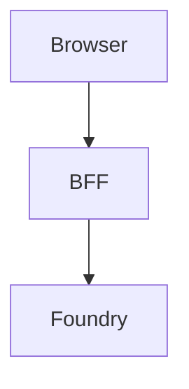

# Charts and diagrams in an answer

> Spec [033](../../specs/033-charts-in-answers/spec.md). What the app draws, what it refuses to
> draw, and why the refusals are the interesting part.

## The shape of the feature

The agent writes a fenced block. The app renders it.

```
agent  ──text_delta──>  BFF  ──SSE──>  browser  ──react-markdown──>  <svg>
                                            │
                                            └── the FENCE is the only signal
```

That is the whole design, and it is the reason this needed a spec. The obvious implementation —
notice the answer has numbers in it, then call a charting tool or ask the model again for a chart —
is the app choosing which tool to call and looping on model output, which constitution §8 forbids.
Rendering a fenced block is the same category of work as rendering the Markdown, the tables and the
syntax highlighting that were already there. Swap the harness and the same text draws the same
picture; that is the test §8 names, and it passes.

Nothing in `frontend/` inspects an answer to decide whether to draw. `react-markdown`'s parser finds
the fence, and `Chart.tsx` imports exactly two things — the i18n context and the chart types — which
a test asserts, because it is the structural form of the same rule.

## The two fences

````
```foundry-chart
{
  "type": "bar",
  "title": "Latency by harness",
  "x": { "label": "Harness", "categories": ["prompt-agent", "hosted"] },
  "y": { "label": "ms" },
  "series": [{ "label": "p50", "values": [1240, 980] }]
}
```


````

`foundry-chart` is namespaced because the schema exists only in this repository — the same reason
this repo's `agent.yaml` is labelled as our schema and not Microsoft's. `mermaid` is plain, because
mermaid genuinely is a standard other tools read.

## What it refuses, and why refusing is the point

`state/chart.ts` is a parser with **named failures**, not a validator returning true. Someone whose
block did not draw is debugging their agent's instructions, and "invalid" tells them nothing.

| Code | The rule |
|---|---|
| `bad_json` | the body is not JSON |
| `unknown_type` | not `bar` or `line` — there is no pie chart |
| `no_categories` · `no_series` | the block declares nothing to draw |
| `too_many_series` | more than four |
| `length_mismatch` | a series has a different number of values than there are categories |
| `bad_value` | a value is not a finite number |
| `missing_label` | a series has no label, so AC7 has nothing to render |

**It repairs nothing.** A series one value short is a failure, not a chart with a gap; a fifth
series is a failure, not four series and a silent omission. Both would be the app deciding what the
data meant (§5). And the failed block stays on screen, in full, copyable — hiding it would make the
failure unteachable, which is the opposite of what this repository is for.

## Four series, measured

The design system had no categorical palette: a brand blue, neutrals, and status colours, which are
reserved and must never stand in for a series. One was built for this spec and **validated** with
the dataviz checker, across every pair rather than only adjacent ones — a chart shows all its series
at once.

```
#0074FF  #B45309  #00998C  #A21CAF     light surface, --pairs all
lightness PASS · chroma PASS · contrast PASS
CVD separation PASS — worst ΔE 12.5 (deutan)
normal vision  PASS — worst ΔE 22.3
```

No fifth hue passed; eight candidates across the wheel each collided with one of these four. That is
why the cap is four and why a fifth series is refused rather than folded into an "Other" nobody
asked for.

One caveat recorded rather than hidden: the worst **tritan** separation is ΔE 4.7. Every series
carries a text label, and that label is the secondary encoding which makes the pair legal — not
decoration. A second theme (spec 036) must re-validate these hues against the dark surface; a dark
palette is selected, never an automatic flip.

## Streaming

A fenced block is invalid for most of its life. It arrives a token at a time, and the app must never
flash a half-parsed chart, nor call a stopped turn's unfinished answer a failure (spec 023).

**`react-markdown` cannot tell you whether the fence closed** — CommonMark says an unclosed fence
runs to the end of the document, so a half-arrived block parses into exactly the same
`<pre><code class="language-…">` as a finished one. That was verified, not assumed, and it is the
one place this feature needed real code: `Markdown.tsx` counts fence markers itself and, while the
last one is open, renders the block as what it is.

## Mermaid is fetched only when a diagram appears

It is roughly 500 kB gzipped against a main bundle of 192 kB, so it loads through a dynamic
`import()` and Vite splits it out. Measured after the change: the main chunk went **192.66 → 196.20
kB gzip** — the chart code — while mermaid's core sits in its own 29 kB chunk that a reader who
never sees a diagram never downloads. A static import anywhere in `src/` would undo that silently,
so a test forbids one.

Mermaid runs at its default `securityLevel: 'strict'` — no HTML in labels, no click handlers. The
source came from a model, and that is worth stating plainly rather than leaving implied.

## The contract with the agent

The schema lives in `ai/harness/_shared/agent_core.yaml`, shared by both harnesses, which is what
keeps "the harnesses differ in the harness only" true (spec 018). **The worked examples in those
instructions are the renderer's test fixtures**: `chartContract.test.ts` pulls every
`foundry-chart` block out of the YAML and runs it through `parseChart`, so an instruction edited to
describe a field the parser does not accept fails on the commit that introduces it (§4).

What that does **not** prove is that the model then follows them. That needs a credential and a real
turn; it is an open item in [`REFERENCES.md`](../REFERENCES.md), not a claim made here.
